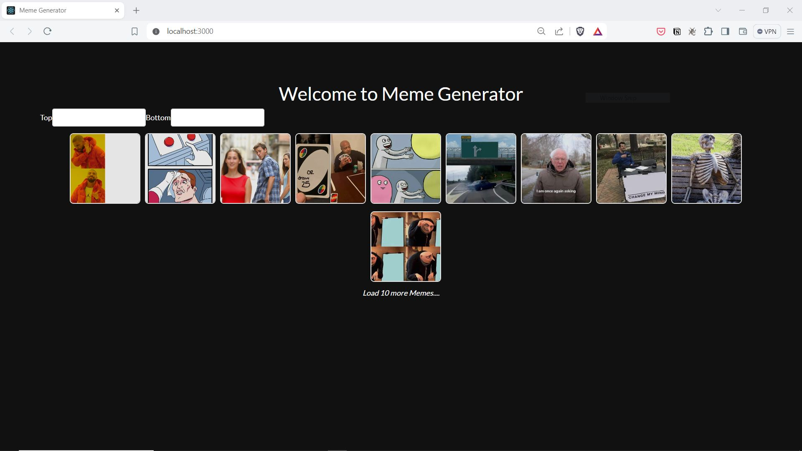
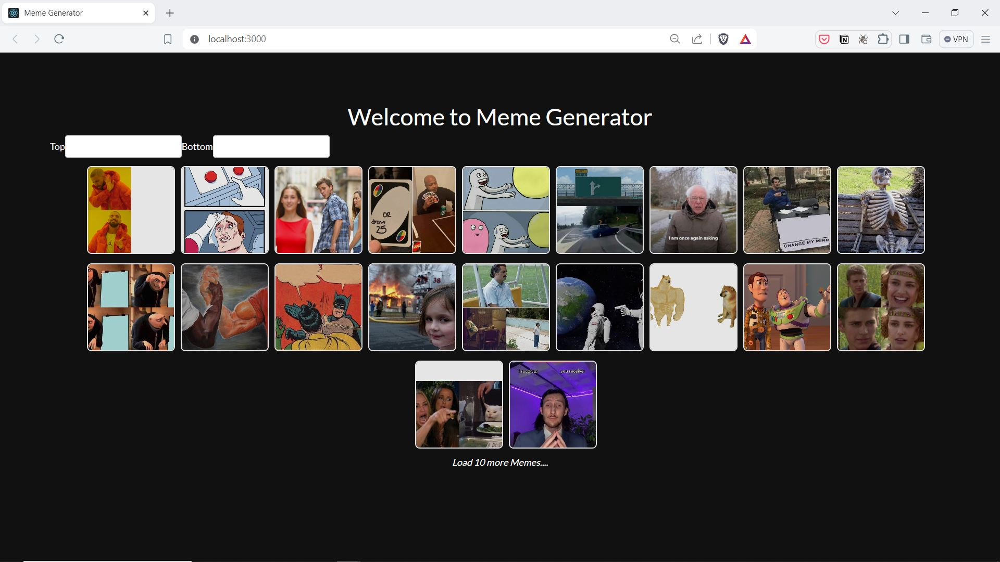
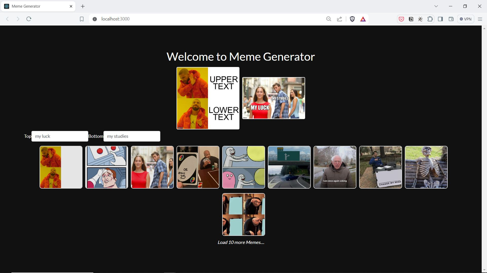

# MemeGenerator

[](https://github.com/ysskrishna/basic-meme-generator/blob/master/LICENSE) [](https://ysskrishna.space)

A Simple Meme Generator using react, ImgFlip APIs

## Project setup
```
npm install
```

Note: update credentials in src\actions\secrets.js


# Images

## Landing Page:


## Landing Page - LoadMore Clicked:


## Landing Page - Memes Created


## Built and maintained by

MemeGenerator is built and maintained by:

| | Name | GitHub | Role |
|---|------|--------|------|
|  | **Y. Siva Sai Krishna** | [@ysskrishna](https://github.com/ysskrishna) | Creator |

## Support

If you find this project helpful:

- ⭐ Star the repository
- 🐛 [Report issues](https://github.com/ysskrishna/basic-meme-generator/issues)
- 🔀 Submit pull requests
- 💝 [Sponsor on GitHub](https://github.com/sponsors/ysskrishna)

## License

MIT © [Y. Siva Sai Krishna](https://github.com/ysskrishna) — see [LICENSE](LICENSE) for details.

---

<p align="left">
  <a href="https://github.com/ysskrishna">Author's GitHub</a> •
  <a href="https://linkedin.com/in/ysskrishna">Author's LinkedIn</a> •
  <a href="https://ysskrishna.space">Author's site</a> •
  <a href="https://github.com/ysskrishna/basic-meme-generator/issues">Report Issues</a>
</p>
